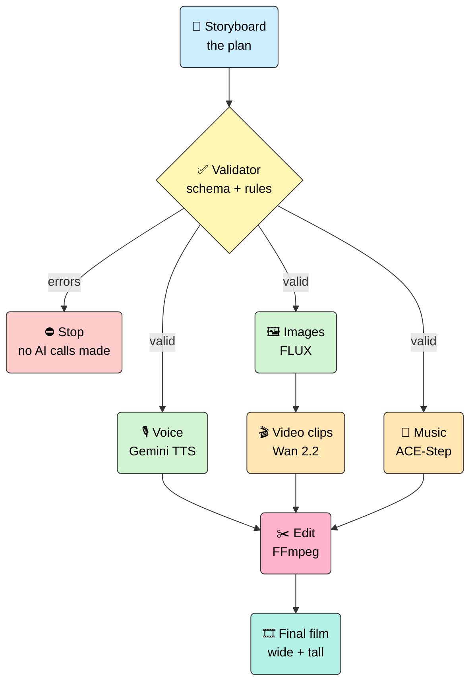

# ARCHITECTURE

## The big picture

| Step | What it does | Tool | Runs on |
|---|---|---|---|
| 📄 **Storyboard** | One file that describes the whole film: shots, Amharic narration, subtitles, image ideas, music style. The only file a person edits. | `storyboard.json` | — |
| ✅ **Validator** | Checks the storyboard before anything runs: the **schema** (right fields and types, 8–12 shots) and the **rules from the brief** (60–90 s, every shot has a reason, subtitles for every line, an AI end card, music cues covering every shot…). Errors stop the run **before any AI call**, so no quota is wasted. | `pipeline/rules.py`, `make validate` | Laptop |
| 🎙️ **Voice** | Turns the Amharic lines into speech and measures how long each line is. | Gemini TTS | Laptop (API) |
| 🖼️ **Images** | Makes one still picture per shot, all in the same style. | FLUX on Cloudflare | Laptop (API) |
| 🎬 **Video clips** | Makes the still pictures move. If it fails, a slow zoom is used instead. | Wan 2.2 | Kaggle GPU |
| 🎵 **Music** | Makes 3 music options; I choose one by ear. | ACE-Step | Kaggle GPU |
| ✂️ **Edit** | Puts it all together: timing from the voice, music quieter under the voice, subtitles, AI labels, end card. | FFmpeg | Laptop |
| 🎞️ **Final film** | Two versions: wide (YouTube) and tall (TikTok/Shorts). | — | — |

**Three ideas behind it**
1. **One plan file controls everything, and it's checked first.** The validator rejects a broken plan before any AI is called. Change a sentence in the storyboard, run `make film`, and only that part is rebuilt (caching).
2. **Plan for failure.** If a service is busy it retries or uses a backup model, and if video fails the film still gets made.
3. **Everything is logged.** Every AI call is written to `runs.jsonl` (model, time, result), so cost and speed are measured, not guessed.

> The **radio cut** (`make radio`) is the same pipeline with only Voice + Music + Edit, on a black screen, to test the story before making any pictures.

---

## Details

| Stage | Script | Reads from storyboard | Writes | Runs on |
|---|---|---|---|---|
| validate | `pipeline/validate.py` | everything | — | local |
| narration | `pipeline/narration.py` | `shots[].narration`, `meta.narration_voice`, `meta.models.tts` | `outputs/narration/<shot>-<hash>.wav`, `manifest.json` (measured durations) | Gemini API |
| keyframes | `pipeline/keyframes.py` | `references[]`, `shots[].image_prompt/era/refs/seed`, style blocks | `outputs/refs/…`, `outputs/keyframes/<shot>-<hash>.jpg`, `manifest.json` | Cloudflare Workers AI |
| clips | `notebooks/wan22_i2v_kaggle.py` | `shots[].motion_prompt/seed/render`, keyframes | `outputs/clips/<shot>.mp4`, `timings.json` | Kaggle T4 |
| music | `notebooks/acestep_kaggle.py`, `pipeline/music.py` | `music.caption/bpm/key/chosen` | `outputs/music/…` | Kaggle T4 / local temp pad |
| assemble | `pipeline/assemble.py` (+ `timeline.py`, `shots.py`, `subtitles.py`) | everything + all manifests | `outputs/segments/…`, `outputs/subs/subtitles_en.srt`, `outputs/final/*` | local FFmpeg |

`make film` = `pipeline/run.py` = validate → narration → keyframes → assemble (music is resolved inside assemble).
`make radio` = narration → assemble `--radio` (black picture, Phase 1 prototype).

## Contracts
- **storyboard.json** is validated in two layers before any model is called:
  1. **Schema** (`schema/storyboard.schema.json`): the *shape* (types, required fields, 8–12 shots, every shot has a `reason`, allowed values).
  2. **Rules from the brief** (`pipeline/rules.py`): what the specification *asks for*. **Errors stop the run**: film longer than 90 s, shot ids not s01…sNN, a reason too short to explain the shot, narration without a subtitle, an end card that doesn't say "AI", music cues that don't cover every shot exactly once, unknown references, a missing chosen score. **Warnings are printed**: text requested inside images, a TTS style instruction (F15), tempo/key in the music caption, no "instrumental", fewer than 3 shot sizes, long motion prompts, unused references, reconstruction shots not mentioned on the end card. Each finding names the part of the brief it comes from. `make validate` prints the report; `make validate STRICT=1` fails on warnings too. Tested in `tests/test_rules.py`.
- **Manifests** (`outputs/narration/manifest.json`, `outputs/keyframes/manifest.json`, `outputs/final/timeline.json`) are the hand-off between stages. Assembly reads only manifests and the storyboard, never a model.
- **GPU stages** live on Kaggle because that is where the free GPU is. Their contract is a file drop: `outputs/clips/<shot>.mp4` and `music.chosen`, plus `timings.json`, which `make import-gpu` appends to runs.jsonl.

## Caching: only what changed is regenerated
Every artefact is named `<item>-<key>.<ext>`, where `key = sha256(stage version, the exact inputs)[:16]`:

| Artefact | Key inputs |
|---|---|
| narration **raw** WAV (costs a TTS request) | text, voice name, style, the whole TTS model chain |
| narration **processed** WAV (free, FFmpeg) | raw file bytes + processing settings (click trim, pause cap, fades, tempo, loudness) |
| reference image | prompt + style block, seed, model |
| keyframe | prompt + style/reconstruction block, seed, model, **bytes** of the reference images |
| segment | **bytes** of keyframe or clip, camera move, length, overlays, aspect, fps |
| mix | **bytes** of each narration WAV + offsets, music bytes, ducking, volume, length |
| final export | keys of segments + mix + subtitles |

If the file exists, the stage logs a `cache_hit: true` line and skips the work. Because downstream keys hash upstream **file contents**, a change propagates exactly as far as it matters. Measured (offline run): editing the narration of s04 re-ran 1 TTS call, 2 segments (s04 16:9 + 9:16), the mix and the 2 exports. Nothing else ran.
Old entries for the same item are pruned so `outputs/` holds only the current version. `STAGE_VERSION` in `common.py` invalidates a stage's cache when its code changes meaningfully.

## Failure handling
| Failure | Handling |
|---|---|
| Broken storyboard | Fails before any call, with the JSON path of every error |
| HTTP 429 / 5xx / timeout / empty TTS response | `with_retries`: exponential backoff (4 s, 8 s, 16 s…), max 3–4 attempts, one log line with `attempts` |
| HTTP 4xx (bad key, bad model id) | Fail fast (retrying will not help), logged with the error, then the next model in the chain |
| A model stays overloaded (503) or out of quota (429) | **Model fallback chain** (`common.with_fallbacks`): each model in `meta.models.{text,tts}` + `*_fallbacks` gets 2 attempts, then the next one is tried. A backup success is logged with `fallback_from`; the sidecar `<file>.json` records which model made each narration line. The cache key covers the whole chain, so a line made by a backup is not regenerated when the primary recovers. Tested in `tests/test_fallbacks.py` (`make test`). |
| Primary image model fails | Automatic fallback to `meta.models.image_fallback` (text-only), logged with `fallback_from` |
| No Wan clip for a shot / clip failed | Ken Burns move over the keyframe (always available) |
| No chosen score yet | Clearly-labelled temp pad from FFmpeg |
| One shot fails in a stage | The other shots still complete. The stage exits non-zero and lists the failed shots, and a re-run only retries those (cache). |
| Kaggle session timeout | The notebook saves each clip and timings.json after every shot and skips finished shots on re-run |
| No API keys | `OFFLINE=1` / `make offline` runs the whole pipeline with labelled placeholders to test timing and assembly |

## runs.jsonl schema
`ts, run_id, stage, item, provider, model, params, seed, status, cache_hit, attempts, latency_s, gpu_s, cost_usd_equiv, output, [error], [fallback_from], [imported]`
`make costs` aggregates it per stage for COSTS.md.

## Audio chain
narration WAVs (click-safe edge trim, 20/60 ms fades, normalised to −18 LUFS each) placed at `shot start + 0.6 s` (first line: + 1.5 s) → music (pre-levelled to -20 LUFS, `volume_db`, 1 s fade-in, fade-out across the end card) → **outro swell** (+4 dB once the last line ends) → per-cue gain curve from the spotting notes (`spotting.cue_gain_expr`, 1.5 s ramps) → `sidechaincompress` keyed by the narration (threshold 0.02, ratio 6, attack 300 ms, release 1500 ms) → sum → **two-pass `loudnorm`** to -14 LUFS integrated, -1 dBTP.

## Picture chain
Square 1024² keyframes → cover-crop to 1280×720 or 720×1280 → `zoompan` at 3× oversampling (no jitter) or a Wan clip (first 0.25 s trimmed, slowed ≤1.6× then last-frame hold) → reconstruction grade and tag → title overlay (Noto Serif Ethiopic) on s01 → concat + end card → burned-in subtitles (≤2 lines × 40 chars, raised in 9:16 for the platform UI safe area) → H.264/AAC, 24 fps CFR, `+faststart`.
